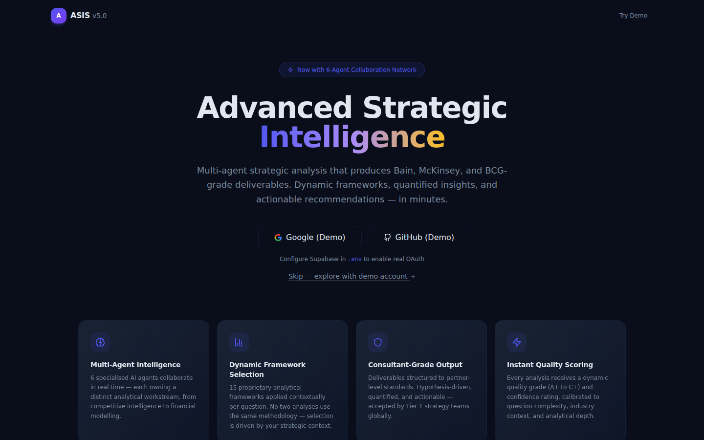
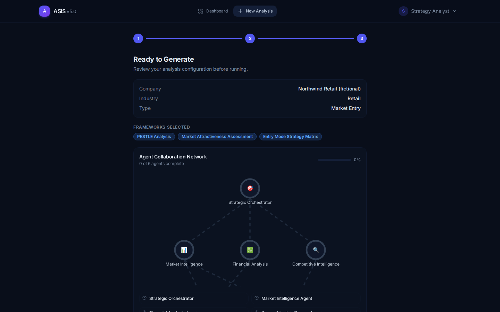
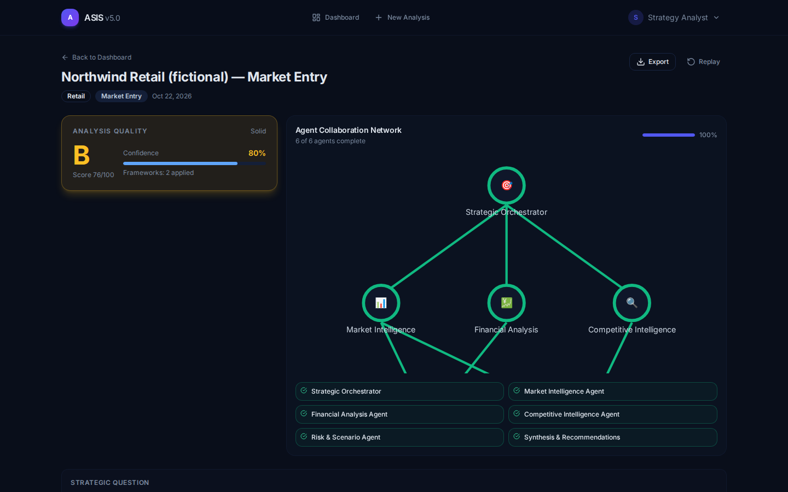
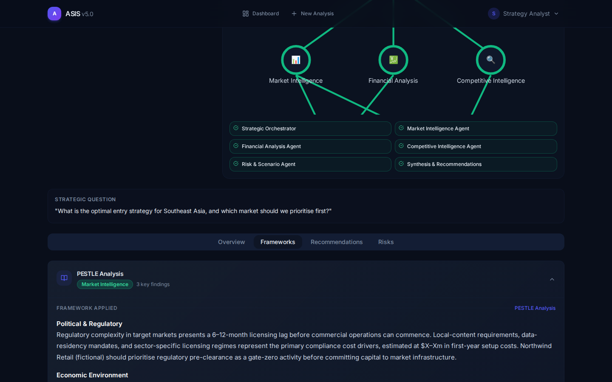
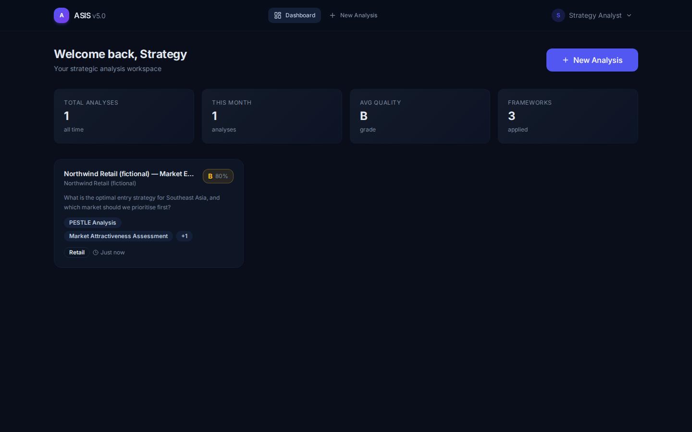
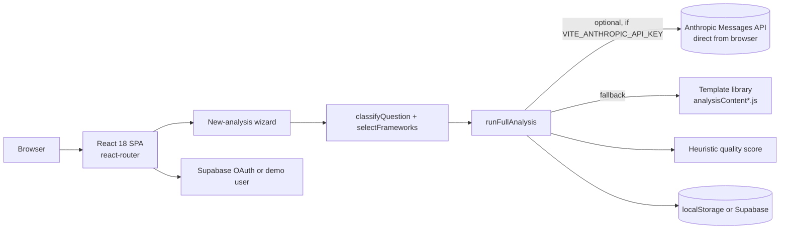

# ASIS-Base44 — "ASIS v5" front-end prototype

**A browser-only React + Vite prototype of the ASIS strategy-analysis experience. It runs fully in demo mode from built-in templates, with optional Claude-generated sections.**

> [!IMPORTANT]
> **This is a side prototype, not the main ASIS project.** The maintained ASIS, with a real FastAPI + LangGraph multi-agent backend, lives in **[Akshatb848/Strategic-Consultant](https://github.com/Akshatb848/Strategic-Consultant)**. This repository was built in a single day (14 April 2026) on the branch `claude/replicate-asis-v5-h5mWO`. As the repository and branch names suggest, it replicates an "ASIS v5" app prototyped with the Base44 app builder. The code here is a standalone Vite app and does **not** use the Base44 SDK or platform.

[](https://github.com/Akshatb848/ASIS-Base44/actions/workflows/ci.yml)
[](LICENSE)


## How it relates to the other ASIS repositories

| Repository | What it is | Status |
|---|---|---|
| [Strategic-Consultant](https://github.com/Akshatb848/Strategic-Consultant) | **Main ASIS codebase**: FastAPI + LangGraph 8-agent backend, Next.js dashboard | **Maintained — use this** |
| [Strategic-Decision-Maker](https://github.com/Akshatb848/Strategic-Decision-Maker) | First full-stack ASIS iteration (3–10 Apr 2026) | Earlier prototype |
| **ASIS-Base44** (this repo) | Front-end-only "v5" replica, no backend | Prototype, not maintained |

## Glimpse

Each screenshot below comes from running this repository (`vite build` + `vite preview`) and driving it headlessly with Playwright: demo sign-in → three-step wizard → generated analysis → dashboard. No Supabase project and no Anthropic key were configured, so **all analysis text comes from the built-in templates**. The company is fictional.

| Landing | New-analysis wizard (step 3) |
|---|---|
|  |  |
| **Generated analysis** | **Framework section (template text)** |
|  |  |



## What it actually does

1. **Sign-in**: Supabase Google/GitHub OAuth when configured. Otherwise a local demo user.
2. **Wizard**: company, industry, stage, analysis type and question. A keyword/type classifier ([`src/utils/frameworks.js`](src/utils/frameworks.js)) picks the question type and its first three frameworks from a fixed library.
3. **Generation** ([`src/utils/runAnalysis.js`](src/utils/runAnalysis.js)): for each framework the app first tries one Claude call through a single "strategist" prompt ([`src/agents/`](src/agents/)). If that fails or no key is set, it falls back to hand-written template text with the company and industry filled in. Recommendations and risks always come from templates.
4. **Display**: tabbed results (overview, frameworks, recommendations, risks), plain-text export, and storage in `localStorage` or Supabase.

**Please read the numbers in the UI correctly:**
- The **quality grade / score / confidence** is a heuristic, not a measurement. [`calculateQualityScore`](src/utils/analysisEngine.js) starts at 75, adds points for "complex" industries/question types and question length, then applies a deterministic ±4 jitter from a hash of the question text.
- The **"Agent Collaboration Network"** is a visual animation of six named roles. There is no multi-agent runtime in this repo. The real multi-agent pipeline is in Strategic-Consultant.
- Template text contains placeholder ranges (e.g. `$X–Xm`). It is not research about the company.

## Architecture



## Tech stack

React 18 · Vite 5 · React Router 6 · Tailwind CSS 3 + shadcn-style components (Radix UI) · Framer Motion · Supabase JS (optional) · Anthropic Messages API via `fetch` (optional) · Vitest · ESLint 9 · nginx/Docker for static hosting

## Quick start

```bash
npm ci
npm run dev          # http://localhost:5173 — click "Skip — explore with demo account"
```

Production build: `npm run build && npm run preview`, or `docker build -t asis-v5 . && docker run -p 8080:80 asis-v5`.

## Environment variables

Copy [`.env.example`](.env.example) to `.env`. All of them are optional, and the app works without any.

| Variable | Purpose |
|---|---|
| `VITE_SUPABASE_URL`, `VITE_SUPABASE_ANON_KEY` | Real Google/GitHub OAuth and cloud persistence |
| `VITE_ANTHROPIC_API_KEY` | LLM-generated framework sections. **Warning:** `VITE_*` variables are bundled into the public JavaScript, so this key is exposed to anyone who loads the site. Use it only locally. |

## Testing

```bash
npm run lint    # ESLint: 0 errors (a few react-hooks warnings remain)
npm test        # Vitest: classifier, framework selection, heuristic score, template-fallback run
npm run build
```

CI ([`.github/workflows/ci.yml`](.github/workflows/ci.yml)) runs all three on every push and pull request. The older `deploy.yml` workflow deploys to a personal GCP VM, needs secrets that only exist in the owner's repo settings, and is now manual-only (`workflow_dispatch`).

## Project structure

```
src/
  pages/        Landing, Dashboard, NewAnalysis, AnalysisDetail
  components/   AgentCollaborationGraph, QualityBadge, FrameworkRenderer, Layout, ui/*
  utils/        frameworks.js (classifier + library), analysisEngine.js (score, workflow, templates),
                analysisContent*.js (template text), runAnalysis.js (orchestration)
  agents/       strategist.agent.js + prompts/strategist.system.txt
  lib/          llmClient.js (streaming fetch + retries), supabase.js
  api/, entities/, hooks/
docs/screenshots/   README images
Dockerfile, nginx.conf, deploy.sh, .github/workflows/
```

## Limitations

- Front-end only. There is no server, so an Anthropic key would have to be shipped to the browser. That is acceptable for a local demo but not for production.
- The analysis content is mostly templated, and the grade is a heuristic (see above). It is not a substitute for real research.
- The strategist prompt tells the model to use "realistic industry ranges" when data is missing. Treat any LLM output as unverified.
- No evaluation of output quality has been performed.
- Not maintained. See [Strategic-Consultant](https://github.com/Akshatb848/Strategic-Consultant).

## License

[MIT](LICENSE) © 2026 Akshat Banga

## Author

**Akshat Banga** — [github.com/Akshatb848](https://github.com/Akshatb848)
